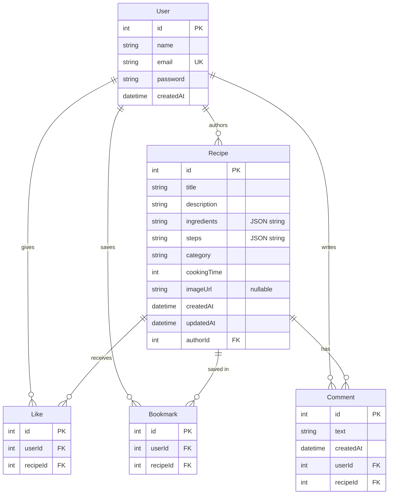

# 🍳 Tastebook

> A modern, full-stack recipe sharing platform where culinary enthusiasts discover, share, like, bookmark, and discuss delicious recipes.

[](https://react.dev/)
[](https://vitejs.dev/)
[](https://nodejs.org/)
[](https://expressjs.com/)
[](https://www.prisma.io/)
[](https://www.sqlite.org/)
[](https://jwt.io/)

Tastebook is built with **React 18 (Vite)**, **Node.js/Express**, **Prisma ORM**, and **SQLite**. Designed as a production-quality full-stack technical assignment, featuring strict server-side authorization, responsive UI design, optimistic updates, and clean modular code.

---

## 📑 Table of Contents

- [Features Overview](#-features-overview)
- [Tech Stack](#-tech-stack)
- [System Architecture & Data Model](#-system-architecture--data-model)
- [Project Structure](#-project-structure)
- [Getting Started](#-getting-started)
  - [Prerequisites](#prerequisites)
  - [1. Backend Setup](#1-backend-setup)
  - [2. Frontend Setup](#2-frontend-setup)
  - [Demo Account Credentials](#demo-account-credentials)
- [API Reference](#-api-reference)
  - [Authentication](#authentication-endpoints)
  - [Recipes](#recipe-endpoints)
  - [Interactions](#interaction-endpoints)
  - [Users](#user-endpoints)
  - [HTTP Status Codes](#status-codes)
- [Key Engineering & Design Decisions](#-key-engineering--design-decisions)
- [Testing the API](#-testing-the-api)
- [Future Roadmap](#-future-roadmap)

---

## 🌟 Features Overview

| # | Requirement | Implementation in Tastebook | Status |
|---|---|---|:---:|
| 1 | **Home Feed** | Responsive recipe card grid with cover images, cooking times, author links, and engagement counters. | ✅ |
| 2 | **Search & Filtering** | Multi-parameter search across titles, descriptions, and ingredients; category filter; max preparation time; sorting (`newest`, `oldest`, `quickest`, `popular`). | ✅ |
| 3 | **Recipe Details** | Full recipe breakdown with interactive prep checklist (tap to check off ingredients while cooking), numbered steps, and author actions. | ✅ |
| 4 | **Create & Edit Recipe** | Dynamic multi-row form with client-side validation, live character limits, and image preview support. | ✅ |
| 5 | **Secure Deletions** | Server-enforced authorization ensuring authors can delete only their own recipes and comments (403 forbidden otherwise). | ✅ |
| 6 | **Social Interactions** | One-click toggling for Likes and Bookmarks with optimistic client UI updates; nested recipe discussions with live comment deletion. | ✅ |
| 7 | **User Profiles** | Author profile displaying engagement statistics (recipes shared, likes received, comments written), user recipes, and private saved/liked collections for the account owner. | ✅ |
| 8 | **Authentication** | JWT-powered session management with bcrypt-hashed passwords (10 rounds) and persistent login state via `AuthContext`. | ✅ |
| 9 | **Persistent Database** | Relational SQLite database managed via Prisma migrations with cascade deletion rules to prevent orphaned records. | ✅ |
| 10 | **Error & State Handling** | Inline field-level validation errors, loading spinners, contextual empty states, and error recovery banners with retry buttons. | ✅ |
| 11 | **Responsive UI** | Mobile-first CSS design tokens with sticky collapsing navigation drawer, responsive grids, and accessible form controls. | ✅ |

---

## 🛠 Tech Stack

### Frontend
- **React 18** — Component-driven declarative UI.
- **React Router 6** — Client-side routing with nested paths, protected routes, and URL search param synchronization.
- **Vite 5** — Rapid development server with transparent API proxying.
- **Plain CSS** — Hand-crafted responsive styling utilizing modern CSS custom properties (design tokens), flexbox, and CSS grid without bloated third-party UI dependencies.

### Backend
- **Node.js & Express 4** — Modular RESTful routing, custom middleware for strict and optional JWT validation, and centralized error handling.
- **Prisma ORM 6** — Type-safe database queries, declarative schema definitions, and automated database migrations.
- **SQLite** — Lightweight, zero-config relational database (easily portable to PostgreSQL by swapping `provider = "postgresql"` in `schema.prisma`).
- **bcryptjs** — Salted password hashing (cost factor 10) for secure authentication.
- **jsonwebtoken** — Cryptographically signed authentication tokens with 7-day expiration.

---

## 🗄 System Architecture & Data Model



### Key Schema Characteristics
- **Compound Unique Constraints:** `[userId, recipeId]` on both `Like` and `Bookmark` models prevent duplicate interactions at the database engine level.
- **Cascade Deletes:** Foreign keys utilize `onDelete: Cascade`. Removing a recipe or user automatically purges associated likes, bookmarks, and comments with zero orphan rows.
- **Array Storage:** SQLite lacks a native array type; `ingredients` and `steps` are serialized as structured JSON strings and automatically deserialized into native JavaScript arrays by server utility helpers before transmission.

---

## 📁 Project Structure

```
tastebook/
├── README.md                      # Project documentation and setup guide
├── client/                        # React Frontend (Vite)
│   ├── index.html                 # HTML application template
│   ├── vite.config.js             # Vite config & API reverse-proxy (/api -> :5001)
│   ├── package.json               # Client dependencies and build scripts
│   └── src/
│       ├── main.jsx               # Application entry point & React DOM root
│       ├── App.jsx                # Application routes & layout wrapper
│       ├── api.js                 # Unified fetch abstraction & bearer token injector
│       ├── styles.css             # CSS design tokens, typography, and responsive rules
│       ├── context/
│       │   └── AuthContext.jsx    # Authentication provider (session, login, signup, logout)
│       ├── components/
│       │   ├── Navbar.jsx         # Navigation bar with responsive mobile hamburger drawer
│       │   ├── RecipeCard.jsx     # Recipe feed card with instant like/bookmark toggling
│       │   ├── ProtectedRoute.jsx # Route guard redirecting unauthenticated users to /login
│       │   ├── Spinner.jsx        # Accessible animated loading indicator
│       │   └── ErrorMessage.jsx   # Error alert banner with retry trigger
│       └── pages/
│           ├── Home.jsx           # Discovery feed with search bar, filters, and recipe grid
│           ├── RecipeDetail.jsx   # Single recipe page, cooking checklist, comments section
│           ├── RecipeForm.jsx     # Unified recipe creation and editing form
│           ├── Profile.jsx        # User stats, published recipes, saved and liked collections
│           ├── Login.jsx          # User login form
│           ├── Signup.jsx         # Account creation form
│           └── NotFound.jsx       # 404 fallback page
└── server/                        # Node.js & Express REST Backend
    ├── package.json               # Server dependencies & dev scripts
    ├── seed.js                    # Idempotent database seeder with demo data
    ├── .env                       # Environment variables (Database URL, Port, JWT secret)
    ├── prisma/
    │   ├── schema.prisma          # Database schema definitions
    │   ├── dev.db                 # SQLite database file
    │   └── migrations/            # Version-controlled SQL migration files
    └── src/
        ├── index.js               # Express application initialization & middleware setup
        ├── prisma.js              # Reusable Prisma client singleton
        ├── middleware/
        │   └── auth.js            # requireAuth & optionalAuth middleware
        ├── utils/
        │   └── recipeHelpers.js   # Recipe serialization & user interaction flag helpers
        └── routes/
            ├── auth.js            # /api/auth (signup, login, me)
            ├── recipes.js         # /api/recipes (CRUD, categories, filtering, search)
            ├── interactions.js    # /api (like toggle, bookmark toggle, comments CRUD)
            └── users.js           # /api/users (user profile, stats, saved & liked recipes)
```

---

## 🚀 Getting Started

### Prerequisites
- **Node.js** version 18.0.0 or higher (`node -v`)
- **npm** version 9.0.0 or higher (`npm -v`)

---

### 1. Backend Setup

1. **Navigate to the server directory and install dependencies:**
   ```bash
   cd server
   npm install
   ```

2. **Configure environment variables:**
   Create a file named `server/.env` (if not already present):
   ```env
   DATABASE_URL="file:./dev.db"
   PORT=5001
   JWT_SECRET="tastebook_super_secret_jwt_key_2026"
   ```
   > ℹ️ **Port Note (macOS):** Port `5000` is reserved by macOS AirPlay Receiver. Port `5001` is used to avoid port collisions.

3. **Initialize the SQLite database and run migrations:**
   ```bash
   npx prisma migrate dev
   ```

4. **Seed the database with sample recipes and the demo chef:**
   ```bash
   node seed.js
   ```
   *(The seed script is idempotent: it will safely skip seeding if recipes are already populated.)*

5. **Start the backend development server:**
   ```bash
   npm run dev
   ```
   The backend API will run at `http://localhost:5001`. You can verify health at `http://localhost:5001/api/health`.

---

### 2. Frontend Setup

1. **In a separate terminal window, navigate to the client directory:**
   ```bash
   cd client
   npm install
   ```

2. **Start the Vite development server:**
   ```bash
   npm run dev
   ```

3. **Open the application:**
   Navigate to `http://localhost:5173` in your browser. All `/api/*` network calls are automatically proxied to `http://localhost:5001`.

---

### 🔑 Demo Account Credentials

For quick evaluation, use the pre-seeded account:

| Field | Value |
|---|---|
| **Email** | `demo@tastebook.com` |
| **Password** | `demo1234` |

---

## 📡 API Reference

All requests and responses use JSON. Endpoints labeled with **Bearer Auth** require the HTTP header:
`Authorization: Bearer <token>`

### Authentication Endpoints

| Method | Endpoint | Auth | Description |
|---|---|---|---|
| `POST` | `/api/auth/signup` | No | Register a new user account. Returns `{ token, user }`. |
| `POST` | `/api/auth/login` | No | Authenticate existing credentials. Returns `{ token, user }`. |
| `GET` | `/api/auth/me` | **Yes** | Validate session token and retrieve current user profile. |

#### Signup Payload (`POST /api/auth/signup`)
```json
{
  "name": "Jane Doe",
  "email": "jane@example.com",
  "password": "securepassword123"
}
```

---

### Recipe Endpoints

| Method | Endpoint | Auth | Description |
|---|---|---|---|
| `GET` | `/api/recipes` | Optional | List recipes with optional search, category, time, and sort filters. |
| `GET` | `/api/recipes/categories` | No | Fetch valid category taxonomy. |
| `GET` | `/api/recipes/:id` | Optional | Fetch recipe details with author data, counts, and comments. |
| `POST` | `/api/recipes` | **Yes** | Create a new recipe authored by the current user. |
| `PUT` | `/api/recipes/:id` | **Owner Only** | Update an existing recipe. |
| `DELETE` | `/api/recipes/:id` | **Owner Only** | Permanently delete a recipe and cascading relations. |

#### Query Parameters for `GET /api/recipes`
| Parameter | Type | Example | Behavior |
|---|---|---|---|
| `search` | `string` | `?search=pasta` | Substring match against `title`, `description`, or `ingredients`. |
| `category` | `string` | `?category=dinner` | Filter by category: `breakfast`, `lunch`, `dinner`, `dessert`, `snack`, `vegan`, `drinks`. |
| `maxTime` | `number` | `?maxTime=30` | Return recipes with `cookingTime <= maxTime`. |
| `sort` | `string` | `?sort=popular` | Sort order: `newest` (default), `oldest`, `quickest`, `popular`. |

*When an `Authorization` header is supplied, each recipe includes boolean flags `likedByMe` and `bookmarkedByMe`.*

#### Create/Update Recipe Payload (`POST / PUT /api/recipes`)
```json
{
  "title": "Creamy Mushroom Risotto",
  "description": "Slow-cooked arborio rice infused with garlic, butter, and wild mushrooms.",
  "category": "dinner",
  "cookingTime": 35,
  "imageUrl": "https://images.unsplash.com/photo-1633964913295-ceb43826e7c9",
  "ingredients": [
    "1.5 cups arborio rice",
    "200g wild mushrooms, sliced",
    "4 cups warm vegetable stock",
    "2 tbsp butter",
    "1/2 cup grated parmesan"
  ],
  "steps": [
    "Sauté mushrooms in 1 tbsp butter until browned, then set aside.",
    "Toast arborio rice with olive oil in a skillet for 2 minutes.",
    "Add warm stock one ladle at a time, stirring continuously until absorbed.",
    "Stir in browned mushrooms, remaining butter, and parmesan. Serve hot."
  ]
}
```

---

### Interaction Endpoints

| Method | Endpoint | Auth | Description |
|---|---|---|---|
| `POST` | `/api/recipes/:id/like` | **Yes** | Toggle like state. Returns `{ liked: boolean, likeCount: number }`. |
| `POST` | `/api/recipes/:id/bookmark` | **Yes** | Toggle bookmark state. Returns `{ bookmarked: boolean, bookmarkCount: number }`. |
| `POST` | `/api/recipes/:id/comments` | **Yes** | Post a comment (`1` to `500` characters). |
| `DELETE` | `/api/comments/:id` | **Author Only** | Delete a comment authored by the current user. |

---

### User Endpoints

| Method | Endpoint | Auth | Description |
|---|---|---|---|
| `GET` | `/api/users/:id` | Optional | Retrieve public profile, community stats, and authored recipes. Profile owners also receive email address, saved recipes, and liked recipes. |

---

### Status Codes

| Code | Status | Meaning |
|---|---|---|
| `200` | OK | Request succeeded. |
| `201` | Created | Resource successfully created. |
| `400` | Bad Request | Validation error (response contains detailed `details` mapping). |
| `401` | Unauthorized | Missing, invalid, or expired authentication token. |
| `403` | Forbidden | Authenticated, but unauthorized to modify another author's resource. |
| `404` | Not Found | Requested recipe, user, comment, or endpoint does not exist. |
| `409` | Conflict | Email already registered. |
| `500` | Internal Server Error | Unhandled server error. |

---

## 💡 Key Engineering & Design Decisions

1. **Server-Enforced Authorization:**
   Client-side button toggling or disabling is treated strictly as an aesthetic convenience. All mutating routes (`PUT`, `DELETE`) inspect `req.userId` against the database entity's `authorId` or `userId`. Attempting unauthorized operations yields an immediate `403 Forbidden`.

2. **Dual-Layer Validation:**
   - **Client Validation:** Delivers instant feedback to users before network requests occur.
   - **Server Validation:** Strict secondary validation on all routes protects against spoofed payloads and malformed requests.

3. **Privacy-Preserving User Profiles:**
   Public profile queries omit email addresses, bookmarks, and liked recipes. Only when `req.userId === requestedProfileId` does the backend reveal private collections and contact information.

4. **Single-Action Interaction Toggles:**
   Liking and bookmarking execute as atomic toggle handlers. One API call adds or removes the interaction and returns both the updated boolean status and total count, eliminating redundant client fetches.

5. **Protection Against User Enumeration:**
   Login failures return an identical generic error message (`"Invalid email or password"`) for both non-existent accounts and wrong passwords to defend against user enumeration attacks.

---

## 🧪 Testing the API

Run this quick cURL sequence in your terminal to test the API directly:

```bash
# 1. Log in as demo user and extract JWT token
TOKEN=$(curl -s -X POST http://localhost:5001/api/auth/login \
  -H "Content-Type: application/json" \
  -d '{"email":"demo@tastebook.com","password":"demo1234"}' \
  | sed -E 's/.*"token":"([^"]+)".*/\1/')

echo "Authenticated Token: $TOKEN"

# 2. Search recipes under 30 minutes
curl -s "http://localhost:5001/api/recipes?maxTime=30&sort=popular" | jq .

# 3. Toggle like on Recipe #2
curl -s -X POST http://localhost:5001/api/recipes/2/like \
  -H "Authorization: Bearer $TOKEN" | jq .

# 4. Post a comment
curl -s -X POST http://localhost:5001/api/recipes/2/comments \
  -H "Authorization: Bearer $TOKEN" \
  -H "Content-Type: application/json" \
  -d '{"text":"Made this for breakfast today, absolutely delicious!"}' | jq .
```

---

## 🔮 Future Roadmap

- [ ] Direct file uploads via Cloudinary / AWS S3 for recipe photos.
- [ ] Cursor-based pagination or infinite scroll for recipe feeds.
- [ ] HttpOnly cookie storage for JWT tokens to enhance XSS mitigation.
- [ ] User profile avatars and bio editing.
- [ ] Automated end-to-end integration tests using Playwright.
- [ ] PostgreSQL deployment on Render or Railway.

---

## 📄 License

This project was built for educational and evaluation purposes as part of a Full Stack Developer technical assessment.
